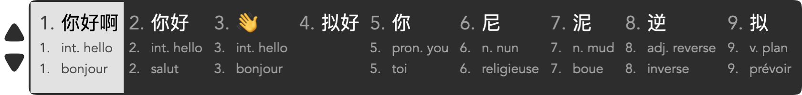
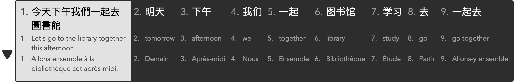

# 鼠须管伴词 · Squirrel Trilingual

**输入中文，同时看见英文和法语；需要时，用快捷键直接输入译文。**

鼠须管伴词是面向 macOS 的 Rime 输入法扩展与定制前端。它将每个候选排成中文、英文、法语三行，让词义跟随日常输入出现，也能在本机翻译完整句子。默认搭配雾凇全拼，适合希望在中文输入过程中接触英语和法语、偶尔切换语言表达的用户。

[下载安装包](https://github.com/CAESIUM001/squirrel-trilingual/releases/latest) · [安装与恢复](docs/INSTALLATION.md) · [从源码构建](docs/BUILD.md) · [验证范围](docs/VALIDATION.md)

*原生候选面板的离屏渲染示例；具体译词会随词表和系统模型变化。*

## 主要功能

- **三行对照**：中文在上、英文居中、法语在下，序号与正文分别对齐。默认横向显示 9 个候选，长译文在对应候选内换行。
- **离线词汇**：232,213 条英文词条，其中 9,872 条带第二义；另有 5,000 条预生成中法词条。常用法语无需等待模型即可显示。
- **本机句子翻译**：使用 Apple Translation 处理英文整句与法语词句，无需账号或 API key。首次使用需下载对应语言包。
- **直接输入译文**：普通数字选择中文，`Option + 数字` 选择英文，`Ctrl + 数字` 选择法语。
- **保留中文输入习惯**：基于鼠须管与雾凇拼音；高级安装可继续使用现有搜狗双拼方案及个人词表。

## 安装

完整功能需要 **Apple Silicon Mac、macOS 15 或更新版本**。当前安装包不提供 Intel 版本。

1. 从 [Releases](https://github.com/CAESIUM001/squirrel-trilingual/releases/latest) 下载 `Squirrel-Trilingual-0.4.0-macOS-arm64.pkg`，打开并完成系统安装流程。安装包内置所需组件，日常安装不需要 Python 或 Xcode。
2. 在菜单栏输入法列表中选择“鼠须管”。安装器会尝试完成注册与启用；若暂未出现，按[安装说明](docs/INSTALLATION.md)检查系统输入源设置。
3. 在“英文与法语翻译”设置中，分别下载中英、中法语言包，并完成 Apple 的系统提示。未下载时，内置词表仍可使用，表外实时翻译暂不可用。

安装器会先备份已有配置和用户级鼠须管，再启用雾凇全拼及本项目的默认功能：横向 9 候选、左右 Shift 切换中英文、三行译文与选词快捷键。已有方案仍保留；个人短语、译词覆盖和用户词频库会保留。已有高度定制配置的用户，请先阅读[安装与恢复](docs/INSTALLATION.md)。

当前发行版采用本地临时签名，**没有 Developer ID 签名或 Apple 公证，PKG 本身未签名**。macOS 可能要求额外确认；安装器不会关闭 Gatekeeper 或自动绕过系统安全检查。请确认下载来自本仓库并核对发布页提供的校验值。

## 快捷键

数字均指**当前候选页的 1–9**。

| 按键 | 行为 |
| --- | --- |
| 空格、普通数字、点击候选 | 照常选择中文 |
| `Option + 数字` | 选择对应英文第一义；已有整句英文时输入完整译句 |
| `Shift + Option + 数字` | 选择英文第二义（该词有第二义时） |
| `Ctrl + 数字` | 选择对应法语词语或整句 |
| 左 Shift 或右 Shift | 切换中英文输入模式，采用安装包默认设置时生效 |
| `Ctrl + Shift + E` | 同时开关英文与法语显示 |

译文尚未出现或没有对应义项时，译文快捷键会保留正在输入的内容。没有候选时，`Ctrl + 数字` 交回当前应用。点击英文或法语所在区域仍选择该格的中文；输入译文请使用快捷键。

## 词语与长句

英文词汇直接查随包词表。没有词表释义、覆盖完整输入的较长候选，停顿后会显示当前高亮项的本机英文翻译；英文整句需至少 6 个汉字。法语优先查询静态词表及内存缓存，表外内容在短暂停顿后翻译，先处理高亮候选，结果逐条出现。单个待译候选最多 300 字符。

*真实 Apple 翻译结果与原生面板的离屏联调示例，使用固定测试输入。*

已有中文前缀和未转换的拼音后缀会在词汇选取时保留。英文整句仅在完整候选可安全替换当前输入时启用。翻页、继续输入或离开输入框后，过期翻译不会覆盖新候选。

## 隐私与性能

内置词表在本地查找，表外内容由已下载的 Apple 模型在本机翻译；本扩展不调用云翻译接口。每种语言独立缓存最近译文，最多 1,024 条、原文与译文合计不超过 2 MiB；动态翻译缓存只在内存中，不写入磁盘。Rime 原有的中文词频学习继续按自身设置工作。

法语词表由公开静态词库预生成，没有使用个人输入历史。固定测试中，首次加载词表并查询 9 个常用词约 3.3 ms；这不包含宿主应用绘制时间，也不是所有设备上的延迟保证。测试条件与范围见[验证说明](docs/VALIDATION.md)。

词表和实时翻译都可能出现多义词、专有名词或上下文判断错误。英文词义可以通过个人词表修正，详见[使用与自定义](docs/USAGE.md)。

## 开发与反馈

- [构建说明](docs/BUILD.md)：前端、翻译设置工具与安装包。
- [验证说明](docs/VALIDATION.md)：单元测试、真实 Rime 引擎、Apple 模型与宿主应用验证之间的区别。
- [提交问题](https://github.com/CAESIUM001/squirrel-trilingual/issues)：请注明 macOS 版本、芯片、输入方案、发生问题的应用和可复现步骤；无需提交私人输入内容或完整用户词库。

## 来源与许可

本项目基于 [Rime / Squirrel](https://github.com/rime/squirrel)，搭配 [雾凇拼音](https://github.com/iDvel/rime-ice)，参考 [青简](https://github.com/qingjian-team/qingjian) 的词义伴随输入思路并使用其英文词表。Lua 扩展与翻译集成为本项目实现；三行面板来自对鼠须管前端的修改。

项目新增代码与相关词表按 **GPL-3.0-or-later** 发布。依赖保留各自许可证，来源、固定版本及数据生成方式见 [NOTICE](NOTICE.md) 和 [LICENSE](LICENSE)。本项目是社区定制版本，与 Rime、雾凇、青简及 Apple 官方没有隶属或背书关系。
